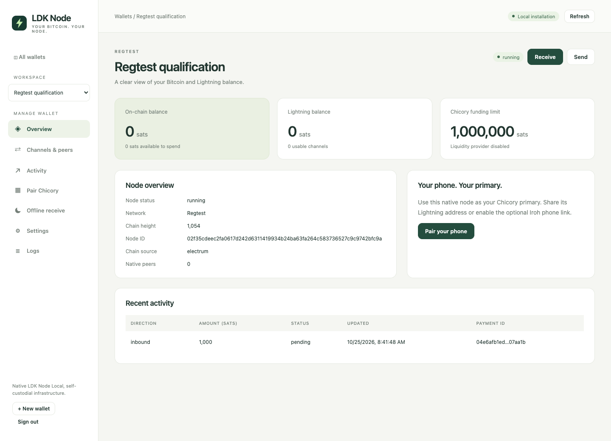

# LDK Node for Umbrel

An Umbrel community app store and dashboard for independent native LDK Node wallets, including experimental Chicory primary support. Supports **Intel/AMD (AMD64) and ARM64**. **Mainnet** is the initial network selection; choose and verify a chain backend before starting a wallet.



## Install on Umbrel

1. Open **App Store**, select the three-dot menu, then **Community App Stores**.
2. Add this store URL: **https://github.com/coreyphillips/ldk-node-umbrel**.
3. Open the **LDK Node** community store and install **LDK Node**.
4. Open the app and sign in with the app password shown by Umbrel. There is no username.
5. Create a wallet, select its network and choose a local Electrum preset or enter a Bitcoin Core RPC, Electrum or Esplora backend. For Fulcrum on the same Umbrel, choose **Umbrel Fulcrum** with SSL disabled. Use **Test connection**, then start the wallet and wait for sync.

Umbrel selects the matching architecture automatically. The app manifest pins the public container image by its multiarchitecture digest. No image loading, command line, GitHub credentials or Docker configuration is needed for this installation. See [installation and backup details](docs/umbrel.md).

This is an experimental test release. All funded interoperability qualification used disposable regtest funds, and installation on physical Umbrel hardware has not yet been qualified. The compatible local Chicory client described below is required for the tested flows.

## Local Electrum hostnames and shorthand

Version 0.1.5 supports this Umbrel's own hostname, including custom names such as `tcp://mint.local:60401`, without entering a LAN IP. It also accepts `mint.local:60401:t` for TCP and `host:port:s` for TLS. Update the app to apply the hostname mapping, choose the matching Bitcoin network, and use **Test connection** before saving. The server must publish its Electrum port on the same host. Other machines' `.local` names still require working container DNS.

## Correct an existing Electrum connection

For Fulcrum installed on the same Umbrel, use **`tcp://10.21.21.200:50002`**, with SSL disabled. Electrs uses `tcp://10.21.21.10:50001`. These match Beignet's local Umbrel presets and avoid relying on `.local` name resolution inside containers.

Update the app, then open the existing wallet's **Settings > Edit configuration**. Stop it first if it is running. Choose **Umbrel Fulcrum** or **Umbrel Electrs**, select **Test connection**, save, and start that same wallet. Its identity and channel storage remain in place. A failed wallet can be edited directly. Do not create a replacement wallet or uninstall the app to repair this setting.

Version 0.1.2 and later also accept a trailing slash in existing Electrum URLs when starting the native node. Other saved server choices remain unchanged. For a server on another device, use its reachable LAN IP or hostname instead of an Umbrel-local preset. [Connection details and troubleshooting](docs/umbrel.md#configure-a-chain-backend).

## Features

- Up to eight independent native nodes with persistent identities and storage.
- Bitcoin and Lightning balances, addresses, invoices, payments, channels, peers, splice operations, native events and offline voucher summaries.
- Chicory primary pairing with selectable TCP, Tor and Iroh URIs and QR codes, with Iroh public relays and endpoint discovery enabled explicitly.
- Separate controls for liquidity provisioning, funding budgets, fees and offline settlement.
- Password sessions, CSRF and Origin validation, private files, bounded administration queues, explicit uncertain transaction outcomes and supervised native processes.

The manager runs the Rust `ldk-node-daemon` through private JSONL pipes. Lightning keys and channel state belong to the native daemon. The optional Iroh bridge carries transport bytes and has a separate transport identity.

## Pair with Chicory

The qualified phone builds use Chicory 0.7.4 with local portable-engine fixes for initial commitment fees, shared splice-input fee accounting and reconnect handling. The iOS 27 build also requires the scene lifecycle correction. This dashboard does not install those changes on a phone. An unmodified store build of Chicory is not qualified by this release. [Client compatibility](docs/client-compatibility.md) identifies the builds, upstream issues and the local setup used for testing.

1. Use the same Bitcoin network on the phone and the primary.
2. In wallet Settings, choose a reachable LAN hostname or IP for TCP pairing. The wallet's public Lightning port is displayed by the dashboard.
3. Enable the Chicory provider if this node should fund phone channels. Review funding caps and fees. Offline settlement is a separate setting.
4. Open **Pair Chicory > Connection method**, choose an available connection, then scan its QR code or paste its URI as an external primary. Switching this view does not change enabled transports, so you can pair one client over Tor while Iroh remains enabled for another.
5. For Iroh pairing, explicitly enable Iroh, public relays and endpoint discovery. For Tor pairing, configure an existing v3 onion address in wallet Settings, mapped to this wallet's native Lightning port. The same address can also be used as a Tor fallback. The dashboard does not create or verify an onion service.

Version 0.1.4 adds **Settings > Recovery & backup**. New wallets have a 24-word recovery phrase with reveal and copy controls. Existing wallets keep their binary seeds and use an encrypted full backup. **Back up all wallets** stops wallet processes and downloads keys, configuration and complete Lightning channel state. Save the file and its password privately, then restart the wallets. See the [backup and offline restore instructions](docs/umbrel.md#back-up-and-restore). Reload the dashboard tab after updating the app.

The primary needs liquidity for its enabled funding and routing functions. Never reuse another live node's storage. Back up complete stopped wallet state; a seed alone cannot restore current Lightning channels.

## Development and local images

```sh
cd manager
npm ci
npm test
```

Use Node 24. Set `LDK_NODE_BIN` to the native daemon, `DATA_DIR` to an unused private directory, and `PUBLIC_ORIGIN` to the exact browser origin before `npm start`.

The container release packages previously qualified native daemon and Iroh binaries with this dashboard. The native LDK compatibility fork and phone patches remain separate local projects and are not published in this repository. Consequently, the complete native release is not reproducible from this repository alone. The [qualification record](docs/qualification.md) includes exact native binary and build-input hashes; [third-party notices](licenses/README.md) include applicable source archives and license texts.

If you have that native source checkout, the full build path is:

```sh
LDK_SOURCE_DIR=/absolute/path/to/ldk-node ./scripts/build-images.sh
```

This exports both architecture archives to `dist/` without pushing them. `scripts/load-local.sh` and `compose.local.yml` support a standalone local Docker installation. Set `.env` with the exact `PUBLIC_ORIGIN` and `ALLOWED_HOSTS` before starting it. The standalone generated password is in `data/dashboard-password`.

Release archives and checksums are available on the [Releases page](https://github.com/coreyphillips/ldk-node-umbrel/releases). The manually dispatched `Publish qualified images` workflow verifies those archives and publishes both architectures to GHCR. It does not rebuild or modify the native binaries. Store updates require an explicit reviewed image digest change.

## Verification and support

The [qualification report](docs/qualification.md) distinguishes native and iOS interoperability checks, container testing and deployment assumptions. Report dashboard or installation problems in [this repository's issues](https://github.com/coreyphillips/ldk-node-umbrel/issues). Include the app version, Umbrel version, architecture and redacted error text. Do not attach wallet data, backups, credentials, seeds or payment secrets.
